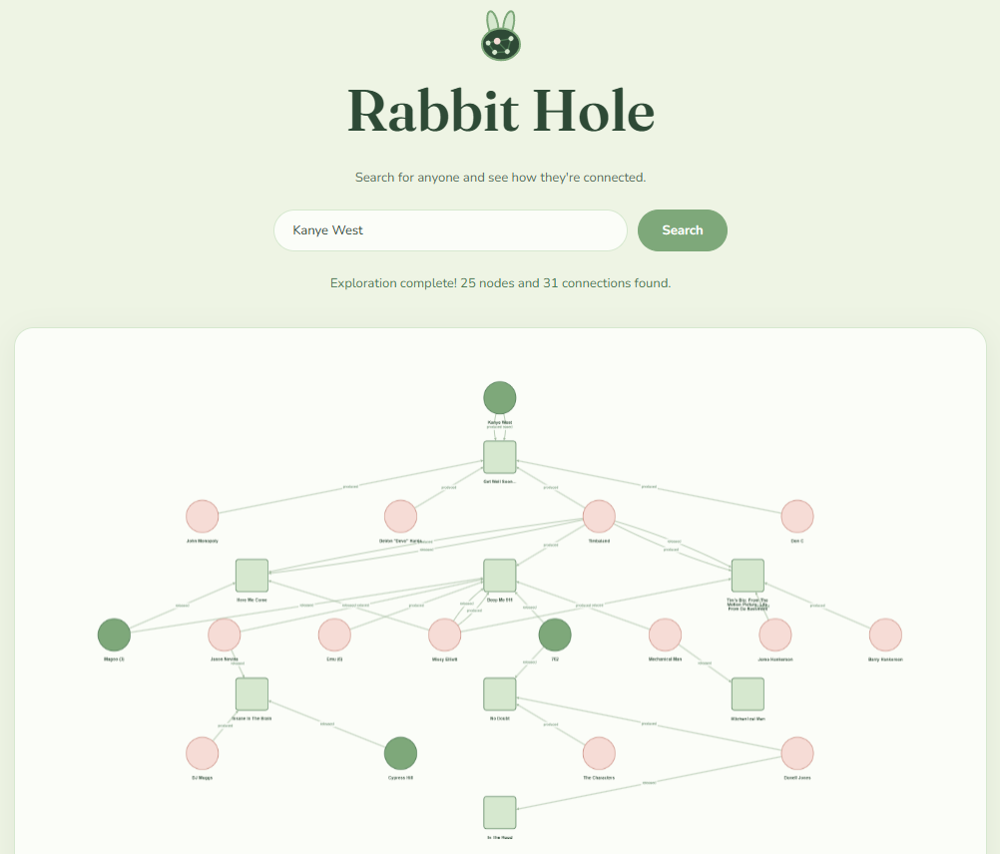

# Rabbit Hole

A web app that visualizes connections between creatives. 

RabbitHole takes in any artist available in the [Discogs](https://www.discogs.com) database, and returns a web of artists, producers, and songs that they are connected to. This visualizes connections in the industry that may have been obscured before.

Try it [here!](https://rabbit-hole-jsap0wcvo-evolved1.vercel.app)

## Dependencies

- [Express](https://expressjs.com)
- [Cytoscape.js](https://js.cytoscape.org)
- [Discogs API](https://www.discogs.com/developers)
- [Vite](https://www.npmjs.com/package/vite)

## Roadmap

RabbitHole has potential outside of just a 36 hour hackathon. With more time, we could implement:

- A self-hosted database for faster connections and no limitations
- AI-Integration which would explain connections in-detail, and answer any questions a user has about them
- Implementation of separate industries, including Film, Video Games, and TV

## Setup

Running RabbitHole locally can allow you to use your own API key for faster graph generation. 

- Make a `.env` file, and include a `DISCOGS_TOKEN` item. 
- Run `npm install` which should download the following packages: 
   - `vite`
   - `express`
   - `dotenv`
   - `cytoscape`

Once you have these set up, you should be able to run the site using `npx vite`